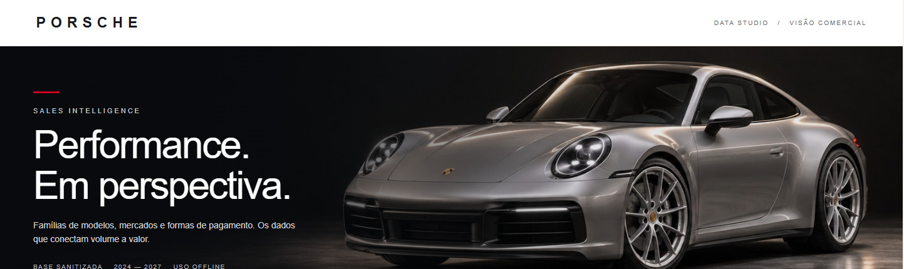
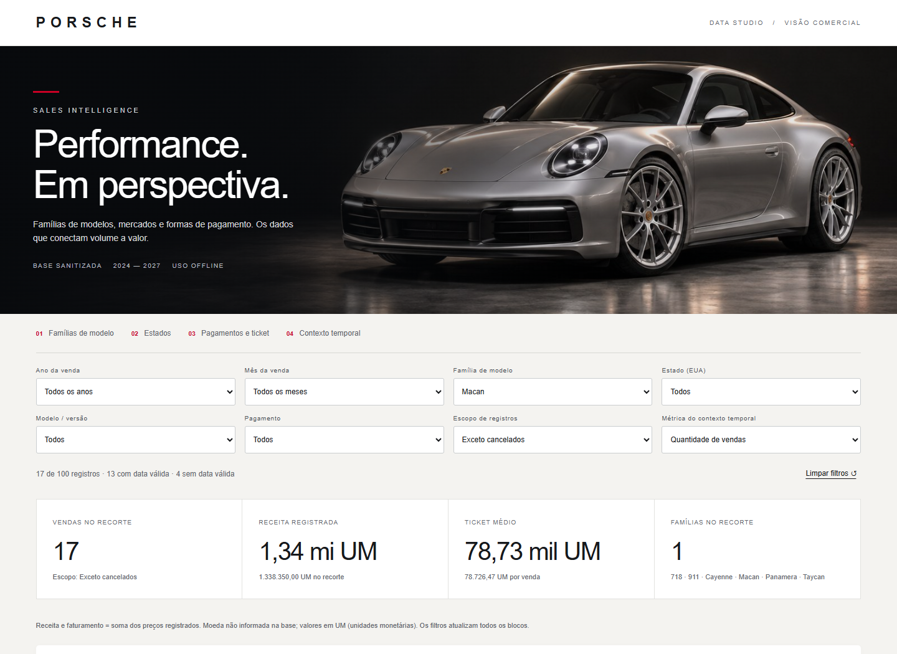

# Porsche Data — Dashboard de Vendas

Dashboard interativo de vendas desenvolvido como projeto do desafio da DIO. A proposta é transformar uma planilha em uma ferramenta de análise comercial, com perguntas de negócio claras, filtros e gráficos em um único arquivo HTML.

O projeto compara volume e valor das vendas por família de modelo e estado, analisa os métodos de pagamento e contextualiza a distribuição dos registros no tempo. O visual foi inspirado na identidade da Porsche Brasil, com tons neutros, detalhes em vermelho e uma imagem automotiva na abertura.

**Dashboard publicada:** [Acessar o dashboard interativo](https://diegodossantos001-max.github.io/dashboard-vendas-porsche-ia/)

## Prévia



## Perguntas de negócio e por que foram escolhidas

Foram escolhidas **três perguntas principais**, alinhadas ao desafio, e um quarto bloco de contexto temporal.

### 1. Quais famílias de modelo geram mais vendas e receita?

**Por que foi escolhida:** volume e receita contam histórias diferentes. Uma família pode vender mais unidades, enquanto outra concentra maior valor por veículo. Essa comparação ajuda a entender a composição do portfólio e a orientar investigações sobre o mix comercial.

**Como o dashboard responde:** dois rankings de barras, lado a lado, mostram a quantidade de vendas e a receita registrada de cada família. O painel apresenta a participação no volume e destaca os líderes e os empates.

**Agrupamento:** as versões foram consolidadas nas famílias **718, 911, Cayenne, Macan, Panamera e Taycan**. Por exemplo, Macan S, Macan T e Macan Electric pertencem à família Macan.

### 2. Quais estados performam melhor em vendas e faturamento?

**Por que foi escolhida:** permite comparar a concentração geográfica do negócio e identificar diferenças entre os mercados com mais vendas e aqueles com maior faturamento. O estado oferece uma visão mais consolidada do que cidades isoladas.

**Como o dashboard responde:** dois rankings exibem quantidade e faturamento por estado, com identificação dos líderes. Os estados são dos **Estados Unidos**, conforme a base; não foram convertidos para estados brasileiros.

### 3. Como o cliente paga, e o método muda o ticket médio?

**Por que foi escolhida:** o método mais frequente pode não estar associado às compras de maior valor. Comparar frequência, ticket e tamanho da amostra ajuda a entender o perfil das transações.

**Como o dashboard responde:** gráficos mostram o número de vendas por método e o ticket médio de cada categoria. Uma tabela expansível apresenta quantidade, participação, receita, ticket e diferença percentual em relação ao ticket do recorte.

**Cuidado de interpretação:** a comparação é descritiva. Uma diferença de ticket pode refletir os modelos e preços vendidos em cada grupo; ela não demonstra que o método de pagamento causa a diferença de valor.

### 4. Como as vendas se distribuem no tempo? — bloco de contexto

**Por que foi incluída:** ajuda a situar os resultados e a observar a distribuição da amostra entre meses e anos. A cobertura temporal e as datas inválidas precisam estar visíveis para evitar conclusões indevidas.

**Como o dashboard responde:** um gráfico cronológico apresenta as vendas mensais, com alternância entre quantidade e valor. Uma tabela resume os anos, e um indicador informa quantos registros e qual valor ficaram fora da análise temporal por falta de data válida.

A distribuição da amostra não comprova tendência ou sazonalidade: os anos têm cobertura desigual e há registros com datas futuras em relação à elaboração do projeto.

## Funcionalidades

- Indicadores de topo: quantidade de vendas, receita registrada, ticket médio e famílias presentes no recorte.
- Filtros por ano e mês da venda, família, modelo/versão, estado e método de pagamento.
- Seleção de escopo: excluir cancelados, considerar somente entregues ou incluir todos os registros.
- Atualização conjunta dos indicadores, gráficos, textos de análise e tabela de registros.
- Comparação simultânea de volume e receita para famílias e estados.
- Exportação do recorte selecionado em CSV.
- Botão para limpar filtros e estados vazios quando a seleção não retorna registros.
- Layout responsivo e imagem de abertura incorporada ao HTML.
- Funcionamento offline, sem instalação ou bibliotecas externas.

## Base de dados e tratamento

**Fonte do desafio:** [Planilha base Porsche — DIO](https://hermes.dio.me/files/assets/8683bed0-cc33-4e06-bca9-04db9c31f9e2.xlsx).

A implementação utilizou o arquivo **porsche_db_sanitized.xlsx**, na aba **Sanitized**. A estrutura efetivamente analisada continha as colunas sanitizadas e campos auxiliares de identificação. Não foi necessário voltar às colunas cruas.

O tratamento aplicado foi:

1. Ler os valores da planilha e selecionar os campos necessários à análise.
2. Converter preços para representação numérica em centésimos de unidade monetária, permitindo somas exatas sem acumular erros de ponto flutuante.
3. Validar as datas no formato ano-mês-dia. Valores `INVALID` foram tratados como ausência de data, sem inventar datas substitutas.
4. Manter o ano do modelo separado do ano da venda. Os filtros e o gráfico temporal usam a data da venda.
5. Agrupar os modelos pelo prefixo da família, preservando a versão original para consulta e filtro.
6. Preservar as categorias originais de pagamento. Transferências wire, bancárias e ACH continuam separadas; os rótulos visuais foram traduzidos.
7. Excluir cancelados por padrão, com opção de alterar esse critério no próprio painel.
8. Incorporar os registros utilizados ao HTML, evitando dependência de fórmulas ou acesso à planilha durante a navegação.

O ano do modelo é um campo categórico de consulta no painel; não foi utilizado para substituir datas nem para operações aritméticas. Na representação incorporada ele permanece como rótulo, enquanto o ano da venda é extraído de uma data validada.

### Qualidade e limites da base

| Item | Resultado ou critério |
| --- | --- |
| Registros de origem | 100 |
| Identificadores de venda distintos | 100 |
| Datas inválidas na origem | 24 |
| Registros cancelados | 7 |
| Recorte padrão, sem cancelados | 93 registros |
| Datas válidas no recorte padrão | 70 |
| Datas inválidas no recorte padrão | 23 |
| Moeda | Não informada; apresentação em UM, unidades monetárias |
| Filiais | Não há coluna que identifique filiais |
| Período com datas válidas | 2024 a 2027, preservado como fornecido |

Cada linha conta como uma venda, pois não existe uma coluna de quantidade de veículos. Nenhum registro foi removido por deduplicação: os 100 identificadores eram distintos.

Sem filtro de ano ou mês, os registros sem data válida entram nos indicadores gerais. Ao aplicar um desses filtros, esses registros deixam o recorte. O bloco temporal considera apenas datas válidas em qualquer situação.

Os registros não cancelados incluem vendas pendentes e em outros estágios. **Receita** e **faturamento**, neste projeto, significam a soma dos preços registrados, não receita contábil reconhecida. O filtro **Somente entregues** permite uma visão restrita aos registros `Delivered`.

### Campos incorporados e privacidade

O HTML contém ID da venda, data, família, modelo, ano do modelo, preço, método de pagamento, cidade, estado e status. Os campos de nome do cliente e vendedor não foram incluídos na versão entregue. A base do desafio é sanitizada; antes de substituir os dados por uma base real, é necessário revisar novamente o que será tornado público.

## Cálculos e validação

- **Quantidade de vendas:** número de registros do recorte.
- **Receita registrada:** soma dos preços do mesmo recorte.
- **Ticket médio:** receita do recorte dividida pela quantidade de vendas do recorte.
- **Participação no volume:** quantidade da categoria dividida pela quantidade total do recorte.
- **Ticket por pagamento:** receita do método dividida pela quantidade de vendas daquele método.
- **Diferença do ticket:** `(ticket do método / ticket do recorte) - 1`.

No recorte padrão, os totais conferidos foram **93 vendas**, **12.202.550,50 UM** e ticket médio de **131.210,22 UM**.

A validação incluiu cálculos independentes em Python e comparação com os resultados do dashboard, utilizando 18 cenários de filtros. Quantidades e valores por família, estado e pagamento foram reconciliados com os totais. Os tickets por pagamento e a soma da série mensal também foram conferidos.

Foram testados filtros, seleção sem resultados, limpeza dos filtros, alternância da métrica temporal, consulta de valores exatos e exportação CSV. A apresentação foi revisada em larguras de 360 a 1440 pixels, sem transbordamento horizontal da página. O funcionamento offline foi verificado sem requisições externas. A imagem foi conferida no Chrome; a tentativa de teste adicional no Edge não pôde ser concluída por falha ao iniciar o navegador de teste.

## Prompt inicial

O prompt que iniciou a construção do dashboard foi:

```text
Analise /mnt/data/porsche_db_sanitized.xlsx e crie um dashboard HTML autônomo,
moderno, elegante e robusto, inspirado na identidade visual do site Porsche Brasil.
Inclua filtros interativos e gráficos para melhores meses de vendas, desempenho
das filiais por quantidade e faturamento, modelo mais vendido geral e por ano,
método de pagamento mais utilizado e estado com maior volume de vendas.
Valide os cálculos e entregue o HTML pronto para abrir no navegador.
```

O caminho acima faz parte do prompt original e aponta para a planilha enviada à IA, que foi analisada a partir dele. A referência visual informada foi o [site da Porsche Brasil](https://www.porsche.com/brazil/pt/).

## Refinamentos até a versão final

### 1. Ajuste às limitações reais da planilha

Durante a análise, foram identificadas datas inválidas, moeda não especificada e ausência de um campo de filial. A primeira versão documentou essas limitações e utilizou cidades como localidades, sem afirmar que representavam filiais.

Também foram definidos critérios explícitos para cancelamentos e para a participação de registros sem data válida nos totais.

### 2. Substituição das perguntas e evolução do design

Depois da primeira entrega, foi solicitado:

```text
Altere as perguntas de negócios para essas abaixo:

1. Quais famílias de modelo geram mais vendas e receita?
2. Quais estados performam melhor em vendas e faturamento?
3. Como o cliente paga, e o método muda o ticket médio?
4. Como as vendas se distribuem no tempo? (bloco de contexto)

Melhore o design do dashboard, se possível colocando um carro na imagem de fundo
do inicio da tabel ou a logo da porsche.
```

Esse refinamento mudou a estrutura da análise:

| Antes | Versão final |
| --- | --- |
| Ranking de modelos e versões individuais | Comparação das seis famílias, por volume e receita |
| Cidades como aproximação de localidades, sem filiais identificadas | Estados, com rankings de volume e faturamento |
| Método de pagamento mais utilizado | Frequência, ticket médio e comparação com a média do recorte |
| Melhores meses e liderança anual de modelos | Evolução mensal e resumo anual como contexto da amostra |
| Abertura predominantemente tipográfica | Abertura com carro, maior contraste e navegação entre os quatro blocos |

O filtro de família foi incluído. A organização passou a priorizar as três perguntas centrais, com o tempo como apoio à interpretação.

### 3. Imagem do carro e ajuste da exibição

Uma imagem ilustrativa de um Porsche 911 prateado foi gerada por IA e incorporada ao HTML. O direcionamento visual foi uma cena de estúdio escura, com o carro à direita e espaço à esquerda para o título.

Após o relato de que a imagem não havia sido localizada no dashboard, as camadas visuais foram ajustadas e uma nova cópia foi salva com o nome `dashboard_porsche_com_imagem.html`. A exibição foi conferida no Chrome, em computador e celular.

A imagem é ilustrativa e não corresponde a uma fotografia de um veículo específico vendido na base. O projeto é independente e não constitui material oficial da Porsche.

## Ferramentas e processo de construção

O projeto foi desenvolvido com o **Codex**, com apoio de habilidades de análise de planilhas, implementação de interfaces, direção de imagem e revisão visual.

- **HTML, CSS e JavaScript:** interface, filtros, cálculos e gráficos.
- **SVG e elementos HTML/CSS:** gráficos sem dependência de bibliotecas externas.
- **Python:** extração dos valores da planilha, preparação e verificação independente dos dados.
- **Geração de imagem por IA:** ilustração automotiva da abertura.
- **Playwright e Chrome:** testes de interação, capturas de tela e revisão responsiva.

O fluxo efetivamente utilizado foi a construção e validação de um HTML autônomo com auxílio de IA. O desafio também mencionava o uso do Canvas, mas a entrega foi produzida como arquivo local; não foi feita uma comparação prática entre o Canvas e um agente personalizado com skill própria.

## Evidência de filtro aplicado

Exemplo com a família **Macan** selecionada e cancelados excluídos: o painel retorna **17 registros**, sendo **13 com data válida** e **4 sem data válida**. Indicadores e gráficos acompanham esse recorte.



Para reproduzir:

1. Abra o dashboard e clique em **Limpar filtros**.
2. Em **Família de modelo**, selecione **Macan**.
3. Confira a quantidade de 17 vendas e a atualização dos blocos.
4. Explore outro estado ou método de pagamento para comparar os resultados.

## Arquivos para o repositório

| Arquivo | Finalidade |
| --- | --- |
| [dashboard_porsche_com_imagem.html](dashboard_porsche_com_imagem.html) | Versão final, com dados e imagem incorporados |
| [previa_dashboard_porsche.png](images/previa_dashboard_porsche.png) | Prévia da abertura do projeto |
| [exemplo_filtro_macan.png](images/exemplo_filtro_macan.png) | Evidência de filtro aplicado |
| README.md | Documentação do projeto |


## Como executar localmente

Baixe `dashboard_porsche_com_imagem.html` e abra o arquivo em um navegador moderno. Não é necessário instalar pacotes, iniciar um servidor ou manter uma conexão com a internet.

## Publicação no GitHub Pages

**Dashboard publicada:** [Acessar o dashboard interativo](https://diegodossantos001-max.github.io/dashboard-vendas-porsche-ia/)

**Repositório:** [Ver código e documentação](https://github.com/diegodossantos001-max/dashboard-vendas-porsche-ia/)


